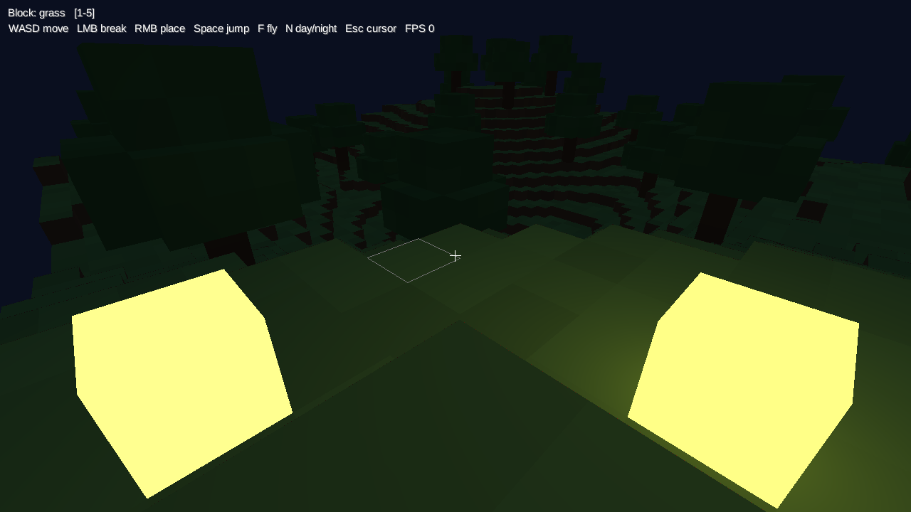

# Kine

[](https://github.com/gabriel-aplok/kine-build-java/actions/workflows/ci.yml)

Kine is a build tool for JVM and Android projects. It uses a Go core, TOML build files, and a content-addressed cache. It does not try to be Gradle. There is no Groovy or Kotlin DSL, no build daemon, and no Gradle plugin ecosystem.

You describe a workspace in TOML and Kine runs the tasks. The result is one static binary, deterministic task keys, and a cache that works across projects and machines with the same platform.

## What it builds

- Java and Kotlin modules, with incremental Java compilation.
- JUnit 5 tests.
- Desktop app images through `jpackage`.
- Android APKs and AABs, including variants, flavors, AAR dependencies, R8, lint, instrumentation tests, native code, and dynamic features.
- JVM plugins with classloader isolation.
- Local Fabric mods.
- Simple Gradle and Maven imports.

## Why Kine

- **Small footprint.** One Go binary. No daemon and no Gradle runtime.
- **Explicit builds.** Build files are TOML. There is no build script that runs arbitrary code at configuration time.
- **Content-addressed cache.** Task outputs are keyed by inputs, dependencies, and tool versions.
- **Bounded parallelism.** Jobs are capped by CPU count and available memory.
- **Linux and Windows.** The same commands work on both.

## Status

Kine is at `0.1.0`. The core, cache, dependency resolution, toolchain, JVM, CLI, plugins, desktop, Android, Minecraft, and import modules are implemented. Config keys and task behavior may change before `1.0`.

## Requirements

- Go 1.24 or later to build Kine.
- JDK 17 or later to build JVM, desktop, Android, and Minecraft projects. Kine does not download JDKs.
- Android SDK with a platform, build-tools, and `adb` for Android projects.
- NDK and CMake for Android native code.
- No Gradle or Maven installation is needed at runtime.

## Install

Build from source:

```sh
git clone https://github.com/gabriel-aplok/kine-build-java.git
cd kine-build-java
go build -o kine ./cmd/kine
```

Or install with Go:

```sh
go install github.com/gabriel-aplok/kine-build-java/cmd/kine@latest
```

On Windows the binary is `kine.exe`:

```powershell
go build -o kine.exe ./cmd/kine
```

Put the binary on your `PATH`, or call it from the build directory.

## Quick start

```sh
cd examples/demo
kine run
```

This builds the `lib` and `app` projects, then runs `demo.App`, which prints `hello from kine`.

A minimal single project looks like this:

```toml
[project]
provider = "jvm"

[project.options]
java = 21
main_class = "demo.App"
```

```java
package demo;

public final class App {
    public static void main(String[] args) {
        System.out.println("hello");
    }
}
```

Put the source in `src/main/java/demo/App.java`, then run `kine` to build or `kine run` to run it.

## Examples

| Directory | What it shows |
|---|---|
| `examples/demo` | Two JVM projects with a project dependency |
| `examples/desktop-demo` | Desktop app image through `jpackage` |
| `examples/android-demo` | Android APK |
| `examples/plugin-demo` | JVM plugin with a custom task |
| `examples/minecraft-demo` | Fabric mod built against a local game jar |
| `examples/compat-maven` | Maven import |
| `examples/compat-gradle` | Gradle import |
| `examples/voxel` | libGDX voxel game for desktop and Android |

Each example can be built from its own directory with `kine`. The voxel example has its own README with controls and Android instructions.

## CLI

```text
kine                         build
kine build [flags] [--variant name]
kine run [flags] [-- args]
kine test [flags] [--variant name]
kine lint [flags] [--variant name]
kine instrument [flags] [--variant name]
kine clean
kine watch [flags]
kine doctor
kine tasks
kine cache info
kine cache prune
kine import [flags] [dir]
kine version
kine help
```

Flags come after the command. Global flags:

- `--jobs int`: maximum parallel tasks, capped by available memory.
- `--project string`: limit seed tasks to one project.
- `--device string`: adb serial for Android runs and instrumentation tests.
- `--variant string`: Android build variant, such as `freeDebug`.
- `--memory-limit string`: Go soft memory limit, default `256MiB`.
- `--cache-dir string` and `--cache-size string`: cache root and cap.
- `--update` and `--offline`: dependency lock updates and network access.
- `--verbose`: debug logs.

Watch flags:

- `--interval duration`: poll interval, default `500ms`.

Import flags:

- `--from auto|maven|gradle`: import source, default `auto`.
- `--force`: overwrite an existing `kine.toml`.
- `--dry-run`: print the config without writing it.

Behavior:

- `build` compiles, copies resources, builds jars, and runs tests. It does not run the app.
- `run` runs the `run` tasks and their dependencies. Arguments after `--` go to the main class.
- `test` runs only the `test` tasks and their dependencies. With no test task it prints `no tests` and exits 0.
- `lint` runs Android lint for every selected variant and writes reports under `build/reports/lint/<variant>`.
- `instrument` builds the test APK, installs the app and test APK, and runs `am instrument`. Reports go to `build/reports/androidTests/<variant>/instrument.txt`.
- `clean` removes each project `build` directory and the project `.kine/deps`, `.kine/tools`, and `.kine/tmp` caches. It keeps `.kine/lock`, `kine.lock`, and the global cache.
- `watch` runs one build, then rebuilds when a file changes. It skips `build`, `.kine`, and `.git`. It does not restart the app. Ctrl+C exits 0.
- `doctor` checks the workspace, project graph, JDK, cache, repositories, plugins, and Android tools when present.
- `tasks` lists task ids and dependencies without running them.
- `cache info` and `cache prune` use the current directory as the workspace root and do not load `kine.toml`.
- `version` prints `kine 0.1.0`.

Exit codes: `0` success, `1` build, test, or doctor failure, `2` usage or config error.

## Configuration

A workspace root lists its members:

```toml
[workspace]
name = "demo"
members = ["lib", "app"]
```

Each member has its own `kine.toml`:

```toml
[project]
provider = "jvm"
depends_on = ["lib"]

[project.options]
main_class = "demo.App"
```

A single project is one `[project]` file with no `[workspace]`.

## JVM projects

A project with `provider = "jvm"` compiles Java and Kotlin, copies resources, builds a jar, runs JUnit 5 tests, and runs the main class.

```toml
[project]
provider = "jvm"
depends_on = ["lib"]

[project.options]
java = 21
main_class = "demo.App"
jar = "app.jar"

[project.options.sources]
java = ["src/main/java"]

[project.options.dependencies]
compile = ["com.example:lib:1.0"]
test = ["org.junit.jupiter:junit-jupiter:5.11.4"]
```

Outputs live under `build/`:

- `build/classes/java/main` and `build/classes/kotlin/main`
- `build/resources/main`
- `build/libs/<jar>`
- `build/test-results`

Set `kotlin = "2.0.21"` for Kotlin sources. Set `compose = true` to pass the Compose compiler plugin. Dependencies resolve from `repositories.toml` and pin in a per-project `kine.lock`.

Java compilation is source-incremental. A changed file recompiles that file and the files that reference its class declarations. A classpath change, a deleted source, or a change covering most of the module falls back to a full compile.

## Desktop projects

A project with `provider = "desktop"` builds the JVM jar and packages it with `jpackage`:

```toml
[project]
provider = "desktop"

[project.options]
java = 21
main_class = "demo.App"

[project.options.package]
name = "Demo"
vendor = "Kine"
version = "1.0.0"
```

Defaults: the name is the project id, the vendor is `Kine`, the version is `1.0.0`, and the destination is `build/dist`. Only `app-image` is supported. Set `icon` to a project-relative image and `java_options` to a list of JVM options.

The `package` task depends on the project jar and writes `build/dist/<name>`. The launcher is `build/dist/<name>/bin/<name>` on Linux and `build/dist/<name>/<name>.exe` on Windows. The task is cached, and the key includes the JDK version.

```sh
cd examples/desktop-demo
kine
./app/build/dist/Demo/bin/Demo
```

## Android projects

A project with `provider = "android"` builds APKs and App Bundles with the installed Android SDK:

```toml
[project]
provider = "android"

[project.options]
compile_sdk = 36
build_tools = "36.0.0"   # optional; defaults to the highest complete install
min_sdk = 24
java = 17                 # optional; defaults to 17
kotlin = "2.4.21"         # optional; uses an installed kotlinc
version_code = 1
version_name = "1.0"
build_types = ["debug", "release"]
flavors = ["free", "paid"]
bundle = true             # optional; build AABs
extra_packages = ["com.example.lib"]

[project.options.build_type.release]
minify = true
proguard = ["proguard-rules.pro"]

[project.options.flavor.free]
application_id_suffix = ".free"
version_name_suffix = "-free"
version_code_offset = 10

[project.options.sources]
java = ["src/main/java", "lib/src/main/java"]
kotlin = ["src/main/kotlin"]
res = ["src/main/res", "lib/src/main/res"]
manifest = "src/main/AndroidManifest.xml"
assets = ["src/main/assets"]

[project.options.native]
cmake = "src/main/cpp/CMakeLists.txt"
abi = ["arm64-v8a"]
build_type = "Debug"
# ndk_version = "30.0.16248370"
# cmake_version = "3.22.1"
# stl = "c++_static"
```

Defaults: `compile_sdk` is the highest installed platform, `min_sdk` is 24, `target_sdk` follows the compile SDK, `java` is 17, `build_types` is `["debug"]`, `flavors` is `[""]`, and the version is `1` and `1.0`. Sources default to `src/main/java`, `src/main/kotlin`, `src/main/res`, and `src/main/AndroidManifest.xml`.

### Kotlin and Compose

Set `kotlin` to the installed compiler version. Kine searches `KOTLIN_HOME`, `~/.local/opt/kotlinc`, `/opt/kotlinc`, and `PATH`. `kotlin_home` overrides the search. The matching `kotlin-stdlib.jar` is copied into `.kine/tools/kotlin/<version>/` and dexed. Kotlin compiles before Java, sees the generated `R.java` sources, and Java compiles against the Kotlin output.

Set `compose = true` to load `compose-compiler-plugin.jar` from the same `kotlinc` distribution and pass `-Xplugin` to the compiler. Add the Compose runtime and UI dependencies yourself. Kine only provides the compiler plugin.

### Variants

Kine discovers `src/main`, `src/<buildType>`, `src/<flavor>`, and `src/<flavor><BuildType>` for Java, Kotlin, resources, assets, and manifests. Higher-priority sets win. Outputs follow Android conventions:

```text
build/outputs/apk/<flavor>/<buildType>/app-<flavor>-<buildType>.apk
build/outputs/bundle/<flavor>/<buildType>/app-<flavor>-<buildType>.aab
build/outputs/mapping/<variant>/mapping.txt
```

`kine build` builds every variant. Add `--variant freeDebug` to `kine build`, `kine run`, or `kine test` to select one.

`application_id_suffix`, `version_name_suffix`, and `version_code_offset` are applied per flavor. Relative manifest components are fully qualified before the application id is renamed.

### AAR dependencies

An AAR dependency contributes `classes.jar`, `res/`, `assets/`, `jni/<abi>/*.so`, `proguard.txt`, and `AndroidManifest.xml`. Kine merges AAR resources and manifests into the app, packages AAR assets and native libraries, and feeds AAR ProGuard rules to R8.

`manifest_merger` selects the merge implementation:

- `auto` (default): use Google's `manifest-merger` when there is more than one manifest or an AAR. Use the built-in Go merger for a single manifest. If the tool cannot be resolved offline, fall back to the Go merger with a warning.
- `android`: always use Google's `manifest-merger`.
- `kine`: always use the Go subset.

`manifest_merger_version` defaults to `32.5.0`. Google's merger provides AGP semantics for `tools:node`, `tools:replace`, `tools:selector`, implicit permissions and features, and library manifests. The Go fast path supports the documented subset.

Kine reads Gradle Module Metadata (`.module`) when a repository publishes it. It selects the variant that matches the consumer attributes (`java-runtime`, the variant build type, and `androidJvm`), follows `available-at` redirects, uses the variant `files` entry for the artifact name and extension, and falls back to the POM when no metadata or matching variant exists.

Dependency resolution uses Gradle-style highest-wins selection. `requires` constraints raise versions, `prefers` participates in selection, `strictly` reports a version conflict when it disagrees with a request, and `rejects` fails on a rejected version. POM dependency-management versions are treated as `requires` constraints. Exact Maven ranges such as `[1.1.0]` and bounded ranges use their lower bound.

### Lint and tests

Android lint requires `cmdline-tools` under the SDK root. `kine lint` writes `build/reports/lint/<variant>/lint-results.txt` and `lint-results.html`.

Unit tests live in `src/test/java` and `src/test/kotlin`. Kine resolves `org.junit.platform:junit-platform-console-standalone` (default `1.11.4`, set `junit_version`), compiles the tests against the app and its dependencies, and writes JUnit XML and text reports under `build/reports/tests/<variant>`. Test classpath resources come from `src/test/resources` by default. Override them with `sources.test_resources`.

Instrumentation tests live in `src/androidTest/java` and `src/androidTest/kotlin`. Instrumentation resources come from `src/androidTest/res` by default, or `sources.android_test_resources`. Kine builds a signed test APK at `build/outputs/apk/androidTest/<variant>/app-<variant>-androidTest.apk`, installs it with the app, and runs the runner from `src/androidTest/AndroidManifest.xml`. When that manifest is absent, Kine generates one with `androidx.test.runner.AndroidJUnitRunner`. Test-only dependencies go in `test_dependencies`:

```toml
[project.options.test_dependencies]
compile = [
  "androidx.test:runner:1.6.2",
  "androidx.test.ext:junit:1.2.1",
  "junit:junit:4.13.2",
]
```

Android instrumentation requires a connected device or emulator. Use `--device <serial>` when more than one device is attached.

### Native builds

When `[project.options.native]` is present, Kine finds the highest installed NDK and CMake under the SDK root and runs CMake with the NDK toolchain. `cmake` defaults to `src/main/cpp/CMakeLists.txt`, `abi` defaults to `arm64-v8a`, and `build_type` defaults to `Debug`. NDK, CMake, and Ninja are not downloaded.

### Release and R8

`build_types` selects debug and release variants. Release options are:

```toml
[project.options.build_type.release]
minify = true
proguard = ["proguard-rules.pro"]
debug = false
```

R8 uses `com.android.tools.r8.R8` from the selected build-tools `lib/d8.jar`. Kine generates keep rules for manifest components, custom views, and native methods, then appends project and AAR rules.

APKs built with build-tools 35 or newer are aligned with `zipalign -P 16`, so uncompressed native libraries are 16 KB page aligned for Android 15 and later devices.

Set `shrink_resources = true` with `minify = true` to remove unused resources. Before linking, Kine builds a resource graph from Java and Kotlin sources, the merged manifest, XML resources, `values/public.xml`, and `tools:keep`, then filters unreferenced values and file resources. R8 shrinks code separately. It no longer rewrites the resource table.

APK and AAB outputs both use the shrunk resource table. Feature modules are code-shrunk with R8 and their resource directories are filtered before linking. Feature resource shrinking keeps resources referenced from module sources, the module manifest, XML resources, `values/public.xml`, and `tools:keep`. Unreferenced values and files are removed.

### Bundles

Set `bundle = true` to build an AAB per variant. Kine links resources in proto format, assembles the base module, resolves `bundletool` from Google Maven into `.kine/tools/bundletool/<version>/`, and runs `build-bundle`. AABs are signed with `jarsigner`. `apksigner` is not valid for AABs.

### Dynamic features and asset packs

Set `bundle = true` and add module tables:

```toml
[project.options.module.feature]
type = "feature"
manifest = "modules/feature/AndroidManifest.xml"
java = ["modules/feature/java"]
kotlin = ["modules/feature/kotlin"]
res = ["modules/feature/res"]
assets = ["modules/feature/assets"]
depends_on = ["base-feature"]

[project.options.module.feature.native]
cmake = "modules/feature/cpp/CMakeLists.txt"
abi = ["arm64-v8a"]

[project.options.module.assetpack]
type = "asset_pack"
manifest = "modules/assetpack/AndroidManifest.xml"
assets = ["modules/assetpack/assets"]
```

A minimal module manifest only needs a package:

```xml
<manifest xmlns:android="http://schemas.android.com/apk/res/android"
    package="com.example.feature">
    <application>
        <activity android:name=".FeatureActivity" android:exported="false"/>
    </application>
</manifest>
```

Kine adds `split`, `<dist:module>`, `<dist:fusing>`, install-time `<dist:delivery>`, `android:isFeatureSplit`, and the feature `android:hasCode` value. Feature modules support Java, Kotlin, Compose, resources, assets, and CMake/NDK native libraries. Asset packs support assets only.

Feature modules can use base classes and base resources that are declared public. Declare those resources in the base module:

```xml
<resources>
    <public type="string" name="app_name" id="0x7f010000"/>
</resources>
```

`depends_on` adds `<uses-split>` entries and orders module compilation, dexing, and packaging. Each feature gets a resource package id starting at `0x80`. Set `package_id` to choose one. Kine builds one module zip per module and passes them all to `bundletool build-bundle`.

Release feature modules use R8 and write `<module>-mapping.txt` beside the base mapping. `kine run` builds and installs an APK set with bundletool when the project has modules.

### Signing

Debug signing uses `[project.options.signing]` or a generated keystore at `.kine/android/debug.keystore`. Release signing uses `[project.options.release_signing]`:

```toml
[project.options.release_signing]
keystore = "release.keystore"
alias = "release"
store_password = "${RELEASE_STORE_PASSWORD}"
key_password = "${RELEASE_KEY_PASSWORD}"
```

A release build without `release_signing` produces `app-release-unsigned.apk` and `app-release-unsigned.aab`.

Signing values may reference environment variables with `${NAME}`. This keeps passwords out of `kine.toml`. Missing release signing variables fail only when a release variant is selected.

Named signing configurations can be selected per build type or per flavor. A flavor selection wins over a build-type selection:

```toml
[project.options.signing_config.play]
keystore = "${PLAY_KEYSTORE}"
alias = "${PLAY_ALIAS}"
store_password = "${PLAY_STORE_PASSWORD}"
key_password = "${PLAY_KEY_PASSWORD}"

[project.options.signing_config.internal]
keystore = ".keys/internal.p12"
alias = "internal"

[project.options.build_type.release]
signing = "play"

[project.options.flavor.partner]
signing = "internal"
```

`version_code_strategy` controls the version code:

- `manual` (default) uses `version_code`.
- `git` uses `git rev-list --count HEAD`.
- `timestamp` uses the current Unix time in minutes.

Flavor `version_code_offset` is still added to the resolved code. The strategy and resolved code are part of the affected task keys. Play requires a positive, monotonically increasing code for every upload.

Set `java = 8` or `java = 11` when the selected build-tools `d8` does not accept Java 17 class files. If an older `d8` still crashes on the compiled classes, pin a newer `build_tools`. For library modules, list their Java and resource directories and add each library package to `extra_packages`. Kine links one resource set and generates an `R` class per package.

The pipeline runs `aapt2 compile`, `aapt2 link`, `kotlinc` when Kotlin is configured, `javac`, `d8` or `R8`, `cmake` when native is configured, `zipalign`, `apksigner`, and `bundletool` when bundling.

```sh
cd examples/android-demo
kine
aapt2 dump badging app/build/outputs/apk/debug/app-debug.apk
apksigner verify --print-certs app/build/outputs/apk/debug/app-debug.apk
```

`kine doctor` reports the Android SDK and keytool when an Android project is present.

## Plugins

A workspace can load JVM plugins that provide tasks. List the jars in `plugins.toml` at the workspace root:

```toml
jars = ["plugins/demo-plugin.jar"]
```

Each jar contains `META-INF/kine-plugin.json`:

```json
{
  "api": 1,
  "id": "demo",
  "version": "0.1.0",
  "main": "demo.DemoPlugin",
  "providers": ["demo"]
}
```

The main class implements `dev.kine.plugin.Plugin`. Providers return `dev.kine.plugin.Task` values with inputs and outputs relative to the project directory. The API jar is written to `.kine/tools/plugin-host/<hash>/kine-plugin-api.jar` after the first plugin build.

Plugins are trusted code. Each jar loads in its own classloader in one JVM host per Kine run. Plugin actions run one at a time in the host.

`examples/plugin-demo` has a complete plugin:

```sh
cd examples/plugin-demo
./build-plugin.sh
kine tasks
kine
```

On Windows, use `build-plugin.ps1` instead. `kine tasks` lists `app:generate`. `kine` runs it and writes `app/build/greeting.txt`.

## Minecraft

A project with `provider = "minecraft"` builds a Fabric mod jar from local game artifacts:

```toml
[project]
provider = "minecraft"

[project.options]
version = "1.20.1"
minecraft_jar = "../game/minecraft.jar"
classpath = ["../game/fabric-loader.jar"]
```

- `minecraft_jar` is a named or deobfuscated Minecraft jar.
- `classpath` holds loader or API jars.
- The mod id and version come from `src/main/resources/fabric.mod.json` unless set, and must match when set.
- The output is `build/libs/<mod_id>-<mod_version>.jar`.
- Set both `mappings` and `remapper` to produce a remapped jar with tiny-remapper. The mappings need `named` and `intermediary` namespaces.

v1 is local-first. It does not download game files, and only Fabric is supported.

`examples/minecraft-demo` builds against a tiny stub game jar:

```sh
cd examples/minecraft-demo
./build-game.sh
kine
unzip -l mod/build/libs/example-mod-1.0.0.jar
```

On Windows, use `build-game.ps1` instead.

## Importing Gradle and Maven

`kine import` writes a `kine.toml` from a Maven POM or a Gradle build in one project:

```sh
kine import ./my-app
kine import --from gradle --force ./my-app
kine import --dry-run ./my-app
```

The importer reads a documented subset:

- Maven: group and version inheritance, properties, scopes, compiler settings, main class, and source directories.
- Gradle: `java`, `java-library`, `application`, and Kotlin JVM plugins, toolchains, common dependency configurations, and the application main class.

It reports skipped constructs to stderr. It does not run Gradle or Maven and does not call an LLM. Multi-module projects, BOMs, project dependencies, and dynamic versions are reported and skipped.

After import, run `kine` in the directory. See `examples/compat-maven` and `examples/compat-gradle`.

## Cache

Task outputs are cached under `<os.UserCacheDir>/kine`. Use `--cache-dir` to change the root and `--cache-size` to set the cap, default `10GiB`. A successful build, run, test, or watch build prunes the cache. Use `kine cache info` and `kine cache prune` to inspect and prune it by hand.

The store is content-addressed. Identical files share one blob, and cached files are hardlinked into the workspace when the platform and volume allow it.

## Dependencies

The `deps` module resolves Maven coordinates for providers. Defaults are Maven Local, Maven Central, and Google Maven. Add `repositories.toml` at the workspace root to change the order:

```toml
[[repository]]
id = "central"
url = "https://repo.maven.apache.org/maven2"

[[repository]]
id = "google"
url = "https://dl.google.com/dl/android/maven2"
```

Resolution writes `kine.lock` next to each project `kine.toml`. Commit it. A matching lock is reused without network requests.

Artifacts are materialized under `.kine/deps` as hardlinks to the content-addressed store. `.kine` is runtime state and should not be committed.

## Toolchain

Kine finds installed JDKs from `JAVA_HOME`, `JDK_HOME`, platform install roots, SDKMAN, asdf, `~/.jdks`, and `javac` on `PATH`. A project pins a Java major version and the highest installed patch is selected.

JDKs are not downloaded. Compilers run as child processes with a minimal environment and an explicit heap cap. Cancellation kills the whole process tree.

## Windows

Kine builds and runs on Windows 10 and 11.

- Set `JAVA_HOME` to a JDK 17 or later. Kine also reads `JDK_HOME`, scans the usual JDK install folders under `Program Files` and `%LOCALAPPDATA%\Programs`, and falls back to `javac` on `PATH`.
- For Android, set `ANDROID_HOME` or `ANDROID_SDK_ROOT`. Kine also checks `%LOCALAPPDATA%\Android\Sdk` and `%USERPROFILE%\Android\Sdk`.
- Build-tools `d8` and `apksigner` are `.bat` files. Kine runs them through `cmd.exe`.
- The cache lives in `%LOCALAPPDATA%\kine`.
- Cancelling a build kills the child process tree with `taskkill /T /F`.

The same commands work in PowerShell:

```powershell
go build -o kine.exe ./cmd/kine
cd examples\demo
..\..\kine.exe run
```

## Voxel demo

`examples/voxel` is a first-person voxel world built with libGDX and Kine. It is a three-module workspace with a shared core, a desktop launcher, and an Android APK.



```sh
cd examples/voxel
kine run --project desktop
```

The first build resolves libGDX from Maven Central. Controls and screenshot options are in the example README.

## Contributing

See [CONTRIBUTING.md](CONTRIBUTING.md).

Run the checks before you open a pull request:

```sh
go build ./...
go test ./...
go test -race ./...
go vet ./...
gofmt -l .
```

From Linux, also check the Windows build:

```sh
GOOS=windows go build ./...
GOOS=windows go vet ./...
```

## License

MIT. See [LICENSE](LICENSE).
